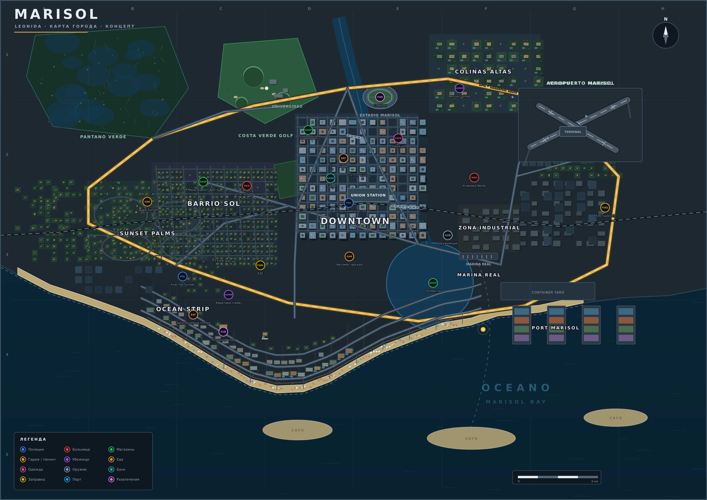

# Марisol — карта города (концепт)



Файлы:

- `city_map.svg` — вектор-исходник (2400 × 1700), правится текстом и скриптом;
- `city_map.png` — растровая версия **3840 × 2720** (4К) для превью и GitHub;
- `viewer.html` — вьюер карты: панорама, зум, LOD-тайлы, 9 мест, скачивание 4К;
- `4k/` — `city_map_4k.webp` (448 КБ), `overview.webp` (1600 px, 120 КБ),
  12 тайлов `tiles/r0..2_c0..3.webp` по 1024 px и `manifest.json`;
- `../tools/make_map.py` — генератор SVG (все районы, дороги и POI заданы в нём);
- `../tools/render_map.cjs` — SVG → PNG 4К; `../tools/make_tiles.py` — WebP, overview,
  тайлы и манифест.

## 4К и LOD: как карта остаётся быстрой

| Слой | Размер | Вес | Когда грузится |
| --- | --- | ---: | --- |
| `overview.webp` | 1600 × 1133 | 120 КБ | всегда, пока карта мелкая |
| тайлы `tiles/*` | 12 × (1024 × 1024) | 0.4 МБ суммарно | только видимые при зуме |
| `city_map_4k.webp` | 3840 × 2720 | 448 КБ | по кнопке «4K ↓» / при полном просмотре |

Вьюер поворачивает карту на GPU (`transform: scale`) и включает тайлы, когда
плотность карты на экране превышает overview:

```
view.s * min(devicePixelRatio, 3) >= 0.42
```

Тайлы 4 × 3 по 1024 px подгружаются лениво и только те, что попали во вьюпорт
(с запасом 64 px), поэтому панорама и зум не требуют 4К-картинку целиком.

```bash
python3 game/tools/make_map.py
node game/tools/render_map.cjs
python3 game/tools/make_tiles.py
```

## Масштаб и координаты

| Параметр | Значение |
| --- | --- |
| Размер полотна | 2400 × 1700 px |
| Масштаб | **1 px = 5 м** |
| Размер города | 12 × 8.5 км |
| Сетка | колонки A–H по 300 px, строки 1–5 по 340 px |

Перевод координат карты в мир игры (Y — вверх, единицы — метры):

```
world_x = (px_x - 1200) * 5
world_z = (px_y - 850) * 5
```

Центр карты — ориентир `D2`. Обратный перевод: `px_x = world_x / 5 + 1200`.

## Районы

| Район | Что это | Ориентиры |
| --- | --- | --- |
| **Downtown** | Небоскрёбы, сетка улиц, банки, магазины | Union Station, Центральный участок, Госпиталь |
| **Barrio Sol** | Плотная старая застройка, мини-маркеты, дворики | Мини-маркет, оружейный рынок |
| **Sunset Palms** | Пригород с петлями улиц и частными домами | Гараж, АЗС |
| **Ocean Strip** | Пляж, отели, набережная, клубы | Пляжный клуб, закусочная |
| **Marina Real** | Залив, причалы, яхты, торговый центр | ТЦ Marina, автозаправка |
| **Port Marisol** | Контейнерный терминал, пирсы, склады | Маяк, контейнерный двор |
| **Zona Industrial** | Склады, ангары, мастерские | Оружейный, автомастерская |
| **Colinas Altas** | Виллы на холмах, закрытые территории | Вилла-убежище |
| **Costa Verde Golf** | Поле для гольфа, парк | Клуб, лунки |
| **Pantano Verde** | Болота, мангры, грунтовые дороги | Мостки, хижины |
| **Aeropuerto Marisol** | Аэропорт: две ВПП, терминал | Терминал, ангары |
| **Estadio Marisol** | Стадион и прилегающая площадь | Арена |
| **Universidad** | Кампус, парк | Библиотека |

## Дороги и транспорт

- **Кольцевое шоссе M-1** (жёлтая линия) связывает все районы; съезды — в Downtown,
  Port Marisol, Colinas Altas и Sunset Palms.
- **Магистрали** — 6 основных проспектов, соединяющих шоссе с центром и портом.
- **Downtown** — регулярная сетка (шаг 34 × 32 px ≈ 170 × 160 м).
- **Железная дорога** проходит с запада на восток через Union Station, с мостами через
  реку и канал.
- **Паромная линия** (пунктир) — от Marina Real к островам Cayo.
- **Река** идёт с севера в залив, по ней — два моста; в Downtown три канала.

## Точки интереса

21 точка, тип закодирован цветом и подписью на карте; в легенде — расшифровка.
Часть точек задаёт игровые системы:

| Тип | Игровая роль |
| --- | --- |
| `POL` | Полицейский участок: спавн копов, розыск, штрафы |
| `MED` | Больница: респавн после смерти, аптечка |
| `SHOP` | Магазины: покупки, ограбление кассы |
| `GAR` | Гараж/тюнинг: сохранение машины, ремонт |
| `HOME` | Убежище: сон, сохранение, гардероб |
| `GUN` | Оружейный: покупка оружия и патронов |
| `BANK` | Банк / банкомат: деньги, ограбление |
| `FUEL` | Заправка: топливо, взрыв цистерны |
| `PORT` | Порт: контейнеры, контрабанда |
| `FUN` | Развлечения: клубы, стадион, гонки |

## Как использовать

1. **Мини-карта в игре** — `4k/overview.webp` как текстура (лёгкая), поверх неё
   маркер игрока (координаты переводятся формулой выше); для детального вида —
   тайлы или `4k/city_map_4k.webp`.
2. **Полноэкранная карта** — `viewer.html`: та же карта в 4К с LOD; сетка A–H/1–5
   годится для адресов вида «D2».
3. **Мир** — районы задают зоны застройки: под каждый квартал есть дома из
   `models/sketchfab/` и `models/polyhaven/`, транспорт и персонажи.

## Что дальше по карте

- карта высот и вода (залив, река, болото);
- дорожный граф для навигации NPC и полиции;
- зоны спавна транспорта и пешеходов по районам;
- интерьеры: участок, больница, магазины, гараж.
